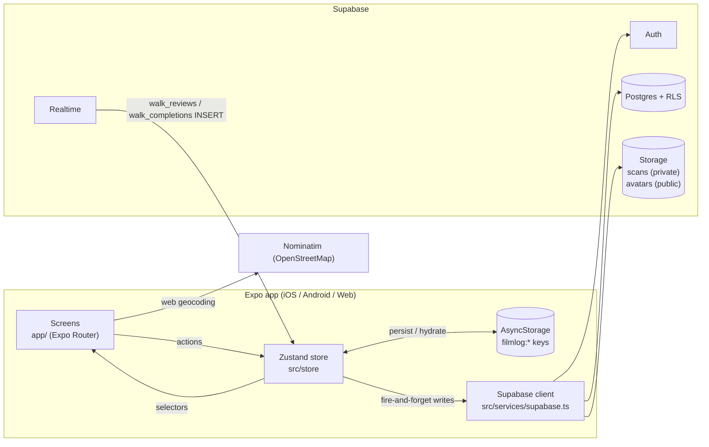

# Architecture

This document explains how Film Log is put together: the runtime layers, how data moves between the device and Supabase, and the conventions that hold the codebase together. For setup instructions and the feature list, see [README.md](README.md).

---

## 1. High-level overview

Film Log is a single Expo (React Native) codebase that ships to **iOS, Android, and the web**. It is **offline-first**: every write lands in a local Zustand store and is persisted to AsyncStorage immediately; Supabase is a background sync target, not the source of truth for the UI.



| Layer | Location | Responsibility |
|---|---|---|
| Routing & screens | `app/` | File-based routes (Expo Router). Screens read from and dispatch to the store; a few read-only public queries (profiles, community data) call Supabase directly. |
| State | `src/store/index.ts` | Single Zustand store: domain data, auth user, notifications, persistence, and sync with Supabase. |
| Backend access | `src/services/supabase.ts` | Supabase client setup plus auth and storage helpers (sign in/up, password reset, scan/avatar upload, signed URLs). |
| Domain model | `src/types/index.ts` | All TypeScript interfaces (`Roll`, `Shot`, `Walk`, `UserProfile`, …). |
| Static config | `src/constants/index.ts` | Theme (`COLORS`, `FONTS`), default gear, option lists, and the `BADGES` definitions. |
| Pure logic | `src/utils/` | IDs, dates, validation (`index.ts`), and badge/stat computation (`badges.ts`). |
| UI components | `src/components/` | Shared components (currently `BadgeToast`). |
| Web shims | `src/mocks/` + `metro.config.js` | Native-only modules swapped for no-op stubs on web. |
| Database | `supabase/*.sql` | Incremental SQL scripts run manually in the Supabase SQL editor. |

---

## 2. Directory layout

```
filmlog/
├── app/                        # Expo Router — every file is a route
│   ├── _layout.tsx             # Root stack, session bootstrap, auth gate, Realtime subscription
│   ├── (tabs)/                 # Bottom tabs: Rolls, Map, Journal, Walks, Settings
│   ├── auth/                   # login, signup, reset-password
│   ├── roll/                   # [id] detail, new, import (native) / import.web (web)
│   ├── journal/[label].tsx     # Per-location journal + frame timeline
│   ├── walks/                  # [id] detail, new (create/edit)
│   ├── profile/[userId].tsx    # Public profile view
│   └── settings/               # gear, profile, stats
├── src/
│   ├── components/             # Shared UI (BadgeToast)
│   ├── constants/              # Theme, defaults, badge definitions
│   ├── mocks/                  # *.web.js stubs for native-only packages
│   ├── services/supabase.ts    # Supabase client + auth/storage helpers
│   ├── store/index.ts          # Zustand store
│   ├── types/index.ts          # Domain types
│   └── utils/                  # Pure helpers and badge engine
├── supabase/                   # SQL scripts, run in numeric order (see §6)
├── metro.config.js             # Web module stubbing
├── app.json                    # Expo config (permissions, scheme, bundle IDs)
└── .env.example                # Required environment variables
```

The `@/*` path alias maps to `src/*` (see `tsconfig.json`).

---

## 3. Application lifecycle

`app/_layout.tsx` owns startup and auth:

1. **Hydrate:** `hydrate()` loads every `filmlog:*` key from AsyncStorage into the store, so the UI is usable before any network call.
2. **Restore session:** `supabase.auth.getSession()` is checked once.
3. **Cross-account guard:** the last signed-in user ID is stored under `filmlog:userId`. If a *different* account signs in on the same device, `clearAllData()` wipes local data first so one user's rolls are never uploaded under another user's account.
4. **Sync:** for the same user, `uploadLocalToSupabase()` pushes local data up (upsert), then `syncFromSupabase()` pulls remote data down and merges it.
5. **Profile & Realtime:** `loadMyProfile()` runs, and `subscribeToCreatorNotifications()` opens Realtime channels while a user is signed in.
6. **Auth gate:** after init, unauthenticated users are redirected to `/auth/login`, and authenticated users are redirected away from `/auth/*`.

`onAuthStateChange` handles mid-session sign-ins and sign-outs using the same logic. It skips the initial event that `init()` already handled, so the app doesn't sync twice.

**Sign-out** (`clearUserData`) clears the session, custom gear, and profile but **keeps rolls locally**. The same user gets them back immediately on re-login without waiting on the network.

---

## 4. State & sync model

### Write path

Every mutating store action follows the same pattern:

```
set(newState)            → UI re-renders immediately
get().persist()          → whole store snapshot written to AsyncStorage
computeBadgeNotifications → diff badge stats before/after, queue toasts
if (user) supabase.…     → background insert/upsert/delete, errors logged only
```

Remote writes are **fire-and-forget**. The only retry path is `addShot`: if its insert fails, it calls `uploadLocalToSupabase()` to upsert everything. Other failed writes are reconciled the next time the app starts or the user signs in.

### Read / merge path (`syncFromSupabase`)

| Entity | Merge rule |
|---|---|
| Rolls | Remote rolls win. Local-only rolls are kept. For rolls that exist in both places, local shots not yet present remotely are appended, so un-synced frames survive. |
| Cameras / film stocks | `DEFAULT_*` constants plus the user's custom rows from Supabase. |
| Journals | Remote journals win, matched by **case-insensitive `locationLabel`**. Local-only labels are kept. |
| Personal walks | Remote walks win, matched by ID. Local-only walks are kept. |
| Completions / my reviews | Replaced by the remote set when the query succeeds. |
| Community walks, walk reviews | Memory-only. Fetched on demand and never persisted. |

There is no timestamp-based conflict resolution: remote rows overwrite local rows with the same ID.

### IDs & mapping

- IDs are generated on the client (`uid()` in `src/utils`) and used as `text` primary keys, which makes offline creation and idempotent upserts possible.
- The store has explicit mappers (`rollToDb` / `dbToRoll`, …) that convert between camelCase TypeScript objects and snake_case columns.
- Array fields (`Shot.tags`, `Walk.tags`) are stored as **JSON strings** in `text` columns and parsed with a try/catch guard.

### Visibility

- **Walks** are stored locally for everyone, but are written to Supabase on create only when `isPublic` is true. Edits to an existing walk always upsert.
- **Rolls** have an `is_public` flag. Public rolls and their shots can be read by any authenticated user (`supabase/04_roll_visibility.sql`).
- **Profiles** are readable by any authenticated user. The `is_public` flag is enforced in the app, not by RLS (see §8).

---

## 5. Feature subsystems

### Scans (media)
- Scans are uploaded to the private `scans` bucket at `{userId}/{rollId}/{shotId}.{ext}`. The storage path is saved in `shots.scan_uri`.
- Scans are displayed through **signed URLs with a 1-hour expiry** (`getScanUrl`).
- Bulk import uses a ZIP: `react-native-zip-archive` on native (`roll/import.tsx`) and `fflate` in the browser (`roll/import.web.tsx`). Filenames are auto-matched to frame numbers, and the user can reassign them before upload.
- Avatars go to the **public** `avatars` bucket at `{userId}/avatar.{ext}` and are served with public URLs.

### Location
- GPS is captured with `expo-location` when a frame is logged, if permission has been granted.
- Turning typed text into coordinates (geocoding) uses `Location.geocodeAsync` on native and the public **Nominatim** API on web (`app/roll/[id].tsx`).
- Every distinct `locationLabel` becomes a **Location Journal**, keyed by label (case-insensitive).

### Badges & notifications
- Badges are **computed entirely on the client** from store data (`src/utils/badges.ts` + `BADGES` in constants). There is no database table for them.
- Each relevant action compares stats before and after, then queues `AppNotification`s that `BadgeToast` renders.
- "Progress nudge" keys that have already been shown are persisted (`filmlog:shownNudges`) so a nudge never repeats.

### Walks & creator notifications
- Walks have ordered stops (`walk_stops.order_index`), completions, and reviews (one per user per walk).
- Denormalized counters (`completion_count`, `avg_rating`) are maintained by `SECURITY DEFINER` RPCs that the client calls after writes.
- When someone else reviews or completes a walk, its creator gets a toast via **Supabase Realtime**:
  - `walk_reviews` INSERT is the primary trigger, because it carries the rating and review text.
  - A `walk_completions` INSERT triggers only if no review event arrives within 4 seconds for the same walk and user.

---

## 6. Database

Tables live in the `public` schema and RLS is enabled on all of them. Each row is owned through `user_id` (or `created_by_user_id` for walks).

| Table | Purpose |
|---|---|
| `rolls`, `shots` | Core film log data. `shots.roll_id` → `rolls.id`. |
| `cameras`, `film_stocks` | User-defined gear. Defaults are not stored. |
| `location_journals` | Notes per location label. |
| `walks`, `walk_stops`, `walk_completions`, `walk_reviews` | Photo walks. |
| `profiles` | Public handle, display name, bio, avatar. |

**Setup order:**

1. The base tables in the README's *Supabase Setup* section (`rolls`, `shots`, `cameras`, `film_stocks`, `location_journals`) plus their RLS policies and the `scans` bucket.
2. `supabase/01_walks.sql`: walk tables, RLS, Realtime on completions, and counter RPCs.
3. `supabase/02_realtime_creator_notifications.sql`
4. `supabase/03_walk_edit_policies.sql`
5. `supabase/04_roll_visibility.sql`
6. `supabase/05_profiles_avatars.sql`

These are hand-run scripts, not a migration tool. Most are written to be re-runnable (`IF NOT EXISTS`, `DROP POLICY IF EXISTS`). The exception is `01_walks.sql`: its `CREATE POLICY` statements fail if the policies already exist.

---

## 7. Cross-platform strategy

- **Platform files:** Expo Router resolves `*.web.tsx` ahead of `*.tsx` on web (e.g. `roll/import.web.tsx`).
- **Module stubs:** `metro.config.js` redirects `react-native-maps`, `react-native-zip-archive`, and `react-native-share` to `src/mocks/*.web.js` on web.
- **Dialogs:** `Alert.alert` is a no-op on web, so screens use an inline "confirm" state instead.
- **Auth on web:** `detectSessionInUrl` is enabled only on web, so password-reset links can be parsed from the URL. The reset screen listens to both `getSession()` and `onAuthStateChange` because Supabase may consume the token before React mounts.

---

## 8. Security model & known limitations

**Secrets.** The client uses only the Supabase **publishable (anon) key**, loaded from `.env` via `EXPO_PUBLIC_*` variables. Anything prefixed `EXPO_PUBLIC_` is bundled into the app and visible to users, so **RLS is the real security boundary**. Never put a `service_role` / secret key in this app.

**Known limitations / tech debt** (contributions welcome):

- **Counter RPCs are spoofable.** Any authenticated user can call `increment_walk_completion` / `refresh_walk_avg_rating` (they run as `SECURITY DEFINER`, without `SET search_path`). Prefer database triggers on `walk_completions` / `walk_reviews`.
- **Overlapping policies.** The README's original RLS block and `supabase/01_walks.sql` define walk policies under different names. Postgres combines permissive policies with OR, so running both is broader than either alone. For example, the README's `read reviews … using (true)` lets *anyone* read *all* reviews. Pick one set.
- **Profiles readable regardless of `is_public`.** Hiding private profiles happens only in the app.
- **No conflict resolution.** Last write wins by ID, and remote data overwrites local data during sync.
- **Whole-store persistence.** Every action rewrites every AsyncStorage key, which is fine at current data sizes.
- **Large screen files.** `app/roll/[id].tsx` is about 2,300 lines and a candidate for splitting into components.
- **Dependency drift.** `expo` is on 55 while several `expo-*` / React Native packages are pinned to SDK 52-era versions (hence `--legacy-peer-deps`). Aligning them with `npx expo install --fix` is recommended.
- **No automated tests** yet.

---

## 9. Conventions

- Add or modify domain types in `src/types/index.ts` first, then update the store mappers.
- Store actions: update local state → `persist()` → background Supabase write.
- Frame-count reductions must go through `validateFrameCountChange()`. Only the last logged frame can be deleted, because film can't be un-exposed.
- Scan attachment is allowed only once a roll is `At Lab`, `Developed`, or `Archived`.
- New Supabase schema changes go in a new numbered file in `supabase/`, written to be re-runnable.
